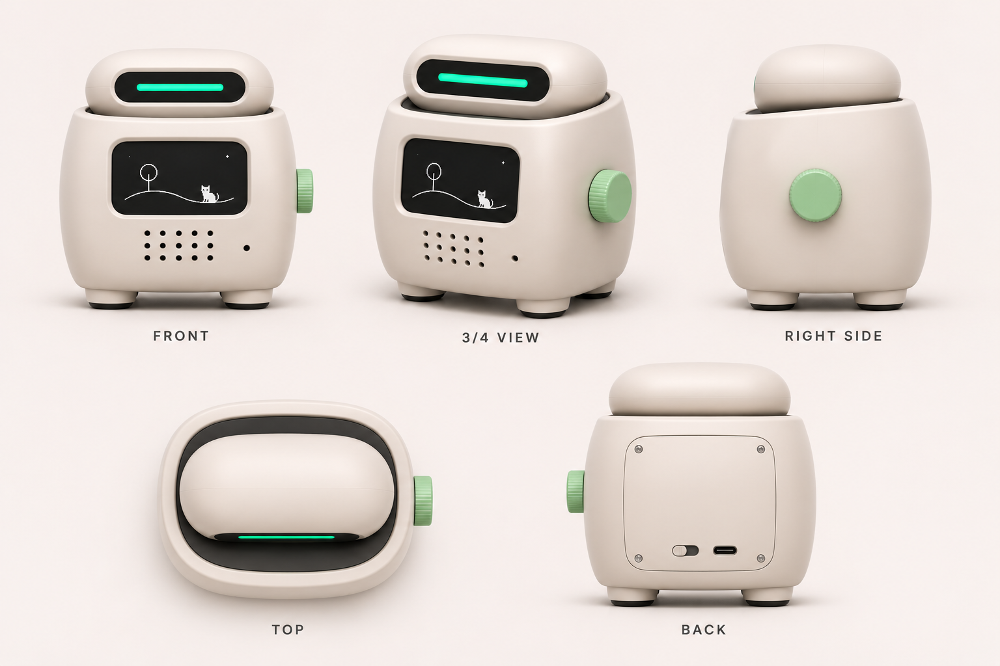

# PANDA

PANDA (Presence-Aware Non-verbal Desk Assistant) is a calm desk companion that helps
you focus, capture thoughts and take breaks through simple physical interactions,
without pulling you away from your work.

**Status:** M2 requirements complete. The breadboard has arrived and Stage 1 bench preparation is underway. This repository contains
the website, requirements and build plans. Build PANDA Connect alongside the device on the breadboard. Final enclosure work follows the complete device-and-app trial.

[Website](https://aman-zishan.github.io/panda/) · [Documentation](https://aman-zishan.github.io/panda/docs/) · [Roadmap](https://github.com/Aman-zishan/panda/milestones)

## Device and companion app

- **Basic** runs locally and includes device firmware, hardware build files and local controls.
- **Connect** is the open-source companion app for setup, voice capture and scheduled reminders.

See the [feature comparison](docs/feature-matrix.md) for planned capabilities and the
[pre-hardware checklist](docs/pre-hardware-checklist.md) for current build work.

## Design files

- [Enclosure concept sketches (PDF)](docs/PANDA_enclosure_concept_sketches.pdf)
- [Original concept (PDF)](docs/PANDA_desk_companion_concept_v1.pdf) — historical proposal. Later choices are recorded in the [decision log](docs/decisions.md).

## Contributing and licences

See [Contributing](CONTRIBUTING.md) to edit and preview the site, or browse the
[documentation index](docs/index.md). PANDA software uses GPL-3.0-only, hardware designs use CERN-OHL-S-2.0, and documentation uses CC-BY-SA-4.0. All three permit commercial use under their terms. See [LICENSE.md](LICENSE.md) for scope and asset exceptions, and the [brand policy](BRAND.md) for use of the PANDA name and logo.
