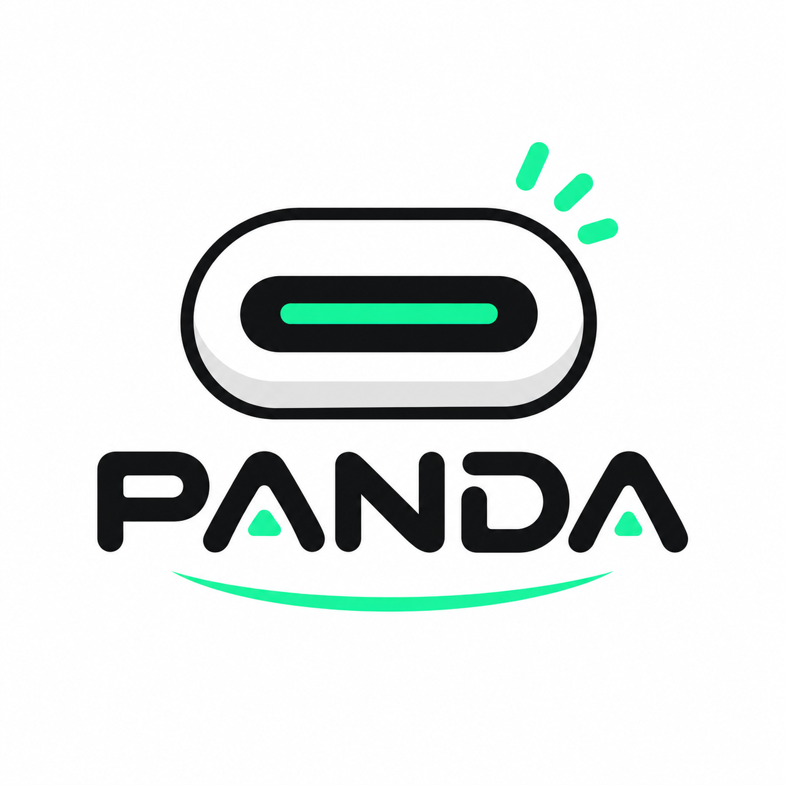

# PANDA

PANDA means **Presence-Aware Non-verbal Desk Assistant**: a calm physical desk
companion for quick voice capture, focus and gentle glanceable feedback.

It should make the next useful action easier without asking for attention, opening a
feed or duplicating a phone.

## Start here

- [Product philosophy](docs/product-philosophy.md) — What belongs on PANDA, what
  belongs in the companion app, and how we avoid building a tiny phone.
- [GitHub milestones](https://github.com/Aman-zishan/panda/milestones) — The live
  roadmap and work tracker.
- [Pre-hardware checklist](docs/pre-hardware-checklist.md) — Work to complete while
  waiting for the Stage 1 delivery.
- [Repository structure](docs/repository-structure.md) — How private product work and
  a later public PANDA Basic release stay separate.
- [Concept document](docs/PANDA_desk_companion_concept_v1.pdf) — The current product
  concept and staged hardware requirements.

## Current status

Planning Stage 1 while waiting for the complete breadboard hardware delivery.

The connected PANDA product is private. A future public PANDA Basic release will be
considered only after the product has been validated.
