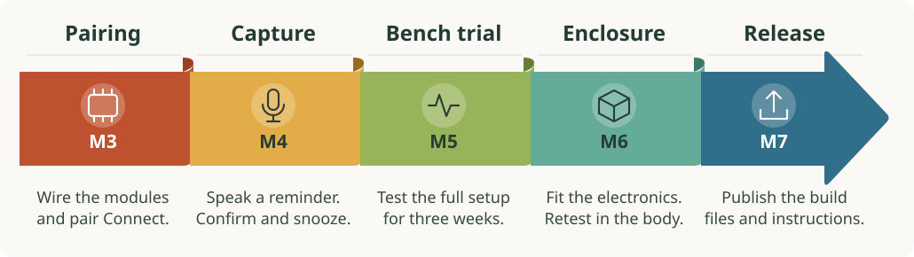

# Roadmap

M0–M2 defined the product. M3–M5 build and test the firmware, companion app and backend together on the breadboard. The enclosure follows the three-week integrated trial.

## M3 · Bring up the board and pair Connect

- **Firmware and hardware.** Flash a minimal ESP32-S3 build and log over USB. Add OLED, onboard LED, encoder, speaker, microphone and Wi-Fi drivers one at a time. Use the verified pin map to implement the local focus timer and tiny-world display.
- **Connect and backend.** Start the Electron, React and TypeScript app with a pairing screen and device status. Start the local FastAPI backend and define the first WebSocket messages for status and settings.
- **Pass when tested.** Pair the real board, change a setting in Connect and see the device acknowledge it. Disconnect the app during a 25-minute focus session and verify the timer finishes. Record the pin map and component checks. [Ticket #16](https://github.com/Aman-zishan/panda/issues/16)

## M4 · Capture a thought and deliver a reminder

- **Firmware and hardware.** Add wake-word and long-press activation, local commands and microphone capture. Show listening, processing, confirmation and failure on the OLED. Turn the knob to snooze a nudge or press to acknowledge it.
- **Connect and backend.** Send captured speech for transcription and interpretation. Save notes and tasks, confirm reminder schedules, and build transcript history and app-only editing. Schedule device nudges and optional desktop follow-up, and reconcile interrupted requests.
- **Pass when tested.** Speak ten reminders from one metre and check the saved text and time for each (target at least nine correct). Also test notes, tasks, editing, snooze, acknowledgement, desktop escalation and reconnect without duplicates over several working days. [Ticket #17](https://github.com/Aman-zishan/panda/issues/17)

## M5 · Integrate presence, privacy and movement

- **Firmware and hardware.** Add radar, physical microphone mute, visor feedback and servo movement on a temporary fixture. Drive break, rest and welcome behaviour from presence. Check that mute blocks both wake-word and manual capture.
- **Connect and backend.** Apply presence conditions to reminders. Integrate calendar quiet mode and opt-in meeting transcription, with approval before scheduling suggested reminders. Verify transcript-only history, cancellation and recovery through the backend.
- **Pass when tested.** Run the complete breadboard for three weeks with presence and movement enabled. Log voice capture, knob use and the tiny world each workday. Check offline behaviour and every planned device/app flow. Resolve failures before starting the enclosure. [Ticket #18](https://github.com/Aman-zishan/panda/issues/18)

## M6 · Package the device and retest

- **Firmware and hardware.** Fit the tested electronics, USB port and moving head. Check the pin map, microphone pickup, speaker output, power and servo travel in the enclosure. Adjust the firmware if the physical build changes the response.
- **Connect and backend.** Repeat pairing, capture, editing, reminders, mute and reconnection against the assembled device. Fix regressions in the app or backend and repeat the affected checks.
- **Pass when tested.** Compare the enclosed build with the passing M5 bench results. Record the final fit, audio, movement, power and connected-flow checks. [Ticket #19](https://github.com/Aman-zishan/panda/issues/19)

## M7 · Publish a reproducible build

- **Firmware and hardware.** Publish the tested firmware, pin map, parts list, wiring, enclosure files and flashing instructions.
- **Connect and backend.** Publish the matching Connect app, backend, integrations, setup instructions and supported platforms. Document service requirements and limitations. Keep credentials and user data out of the release.
- **Pass when tested.** Verify a builder can assemble and flash PANDA, start Connect and reproduce the documented setup from the published files. Check attribution, asset permissions and the PANDA Noncommercial Licence. [Ticket #20](https://github.com/Aman-zishan/panda/issues/20)
